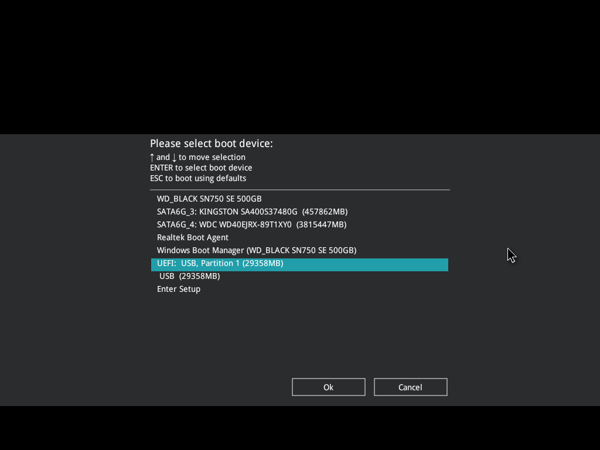
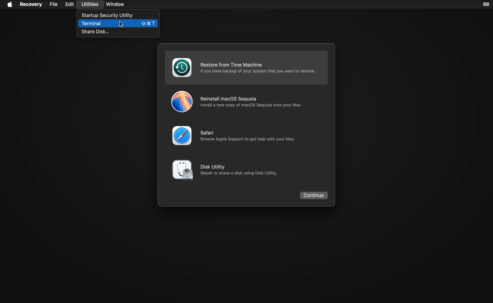
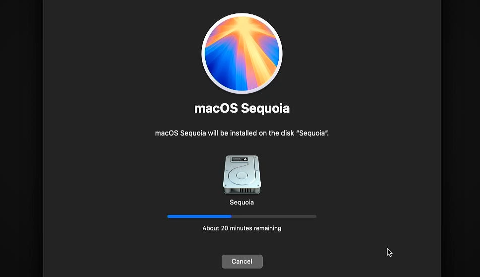
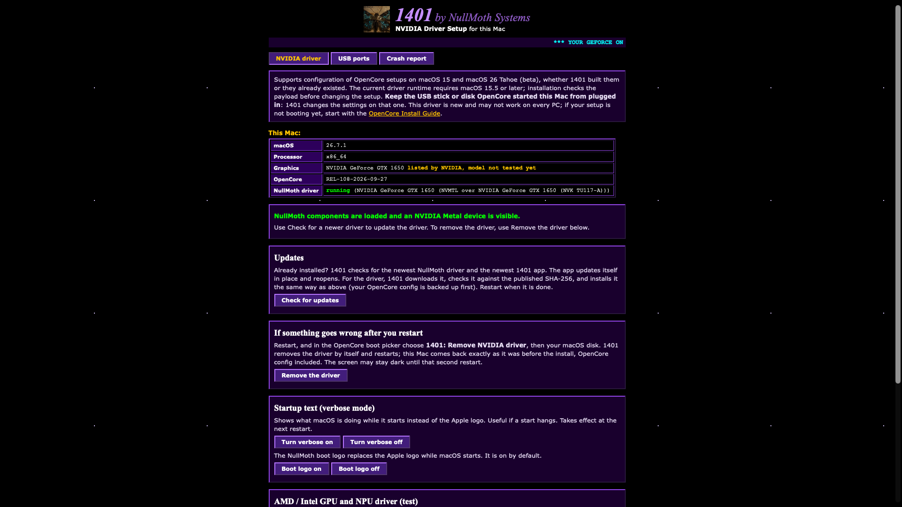

# Installing macOS

You've finally made your EFI, hopefully, so time to boot that thing, or whatever they say.

Restart your computer and spam the heck out of whatever the boot menu key for your BIOS is. Mine is F8, but it can also commonly be F12, F11, F9, or Esc. You can also Google search what it is, but after you've selected it, boot off the USB. (and make sure it's the UEFI one)

 You can also directly go into the UEFI setup and select the USB as an override, if you can't find the boot key. 

## OpenCore Time

Hopefully, by waiting a minute at maximum, you should be at the OpenCore boot menu. You'll likely have a few options at this point. Make sure to select:
<code> 1401 (external) (DMG) </code>
(or, if you made your own EFI, whatever the name of the USB is. Might be Untitled.)
And with that.. you should be off! It should be going through and booting recovery, as no drivers or kexts are loaded. If it hangs somewhere here, this may indicate a problem with your EFI, so go back and check that.

From here, it's also pretty straight-forward. Head into Disk Utility first, and format your drive (Hint, you may need to go to the top menu bar under View, and click "Show All Devices") to APFS and give it a cool name. I went for "Macintosh HD", because it's the standard.

::: tip Dualbooting

This driver and installation method does support dual-booting. Just make sure to only format the partition you want as APFS, and the OpenCore menu should pick up a Windows install.

:::

Then, granted you have an active internet connection (if in doubt, open Utilities -> Terminal, and type in <code>ping 1.1.1.1</code>), you should be able to advance through installing macOS without much hitch. Do note, that the estimation of time it'll take for it to install is **much** longer. It may say two hours at first, but do note, with a fairly standard internet speed, it only takes about 20-30 minutes.

Afterwards, it will reboot a couple of times, but do make sure to boot off the USB *every time*, and select either:
    * macOS Installer
    * Your drive name (whether Macintosh HD or otherwise)
Don't panic if it reboots after selecting one. Try a couple more times, it might still be doing some things.

After you've installed, hopefully it all goes fine, and you're in the.. very.. *fun* OOBE. Just get through it as quickly as possible, and more likely than not it'll stutter and resist efforts a lot. After you're through, you might be on the desktop! Congrats! It might not look very pretty due to the lack of *any drivers*, but this is where the fun begins.

## Driver installation
Depending on how you set up the EFI, there's two potential ways to get the driver: 
    * In the /Nullmoth folder of your USB
    * Downloading from the GitHub

### 1401 App
::: tip For those who used the 1401 Windows app

You will more than likely have a folder on the "1401" USB that is titled "Nullmoth" - in there, the DMG and the .tar.gz should exist. If not, continue along with the following instructions.

::: 

Hopefully at this point you still have an active internet connection, and if that's the case, head on over to [the download page](https://nullmothsystems.com/downloads) and grab yourself the driver. It is your choice here, <code>1401-Mac.dmg</code> is a the one you want. Mount it, and drag the 1401 application to your Applications folder.

macOS will throw a tantrum about this. Something something, $99 codesigning. When macOS says it won't open the app, open System Settings, scroll down to Privacy & Security, scroll down again (sorry, scrolling finger!), and where it says "1401.app was blocked to protect your Mac", click "Open Anyway". It will prompt for your password, and boom, you should be *in there.*
 

This image is taken from an already installed driver, but it's as simple as just pressing "Update" (or the substitute), which will happily download the driver for you, and hopefully move the EFI to your main drive, so you can throw away the USB. (well, don't actually do this. You might need it again if something goes catastrophic.)

::: warning If it fails relating to the EFI
You will need to mount your EFI manually, and maybe move the EFI folder to the drive manually (aswell as install the driver manually) if it refuses to install even after mounting the EFI. To do so:
    * Open terminal, type <code>diskutil list</code>
    * Find the EFI partition, which is probably the first, biggest drive, for example, <code>disk0s2</code>
    * Mount the EFI partition by doing <code>sudo diskutil mount disk0s2</code>, replacing <code>disk0s2</code> with your actual drive.
    Only follow the below if the app fails to install after mounting:
    * Copy the <code>EFI</code> folder from your mounted USB EFI to the internal EFI. This will allow you to reboot without the USB drive.
    * Continue on with the manual install below.

:::
Afterwards, go back to System Settings, then Privacy & Security, and it might say it was blocked. Make sure to allow it in the exact same spot you had to force open the app, then finally, reboot. 

### Manual install

This is only needed if the 1401 app fails to do a damn thing.

Either from the USB stick, or from the website, download & extract <code>nullmoth-nvidia.tar.gz</code>. You should have a folder named "pkgroot".

Open Terminal, and type <code>sudo</code>, and then drag <code>install.sh</code> into the terminal. The final command should be something like:
<code>sudo /Users/me/Downloads/pkgroot/install.sh</code>, and then enter your password and watch it install.
Following the same steps as the app, open Privacy & Security settings in.. well, System Settings, and allow the driver to come through. If you're an epic CLI-terminal gamer, you can simply just type:
<code>sudo shutdown -r now</code>
..and have it reboot for you. Isn't that dandy?

## Post-install
If that all went well, you should be in the OS. Initially, it **will flicker and bug out**, for now atleast. Just wait about a minute or so, and it should come back to normal. If you login and it's still flickering, open Terminal and type:
<code>sudo killall WindowServer -9</code>, which will log you out, and then log back in. You should be fixed!
On the other hand, if something goes terribly wrong and you're stuck and banging your head and crying at the world making you suffer, head on over to [troubleshooting](../troubleshooting/troubleshooting.md). It might actually be quite likely that you have to go there.

::: danger Things That Do Not Work Right Now
A couple things do not work, most notably:
    * WebGL
    * DRM content/encoding (like playing GIFs/videos on Discord, or trying to watch Netflix)
    * Certain Metal applications that try pick up a GPU
    * Benchmarking software
    * OpenCL (half-functional)
::: 

