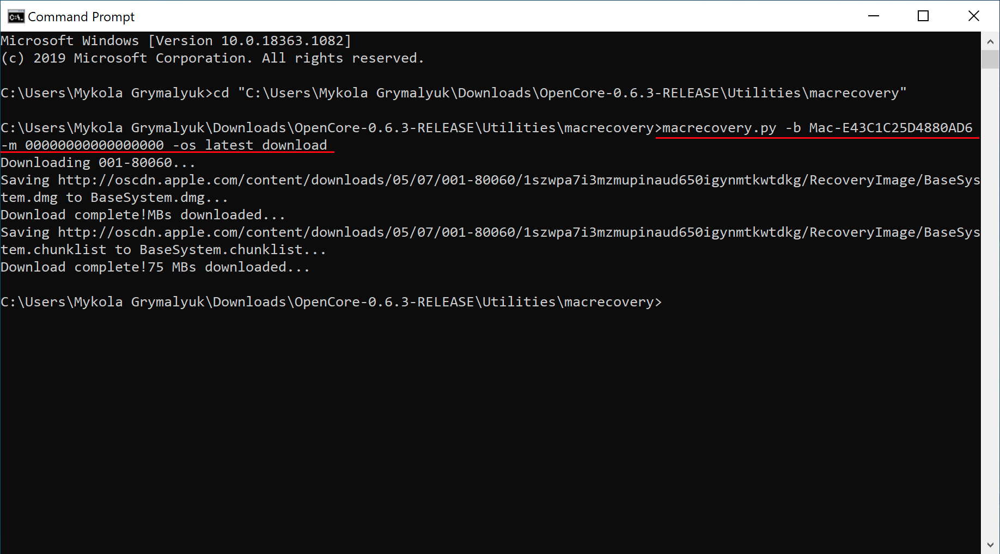
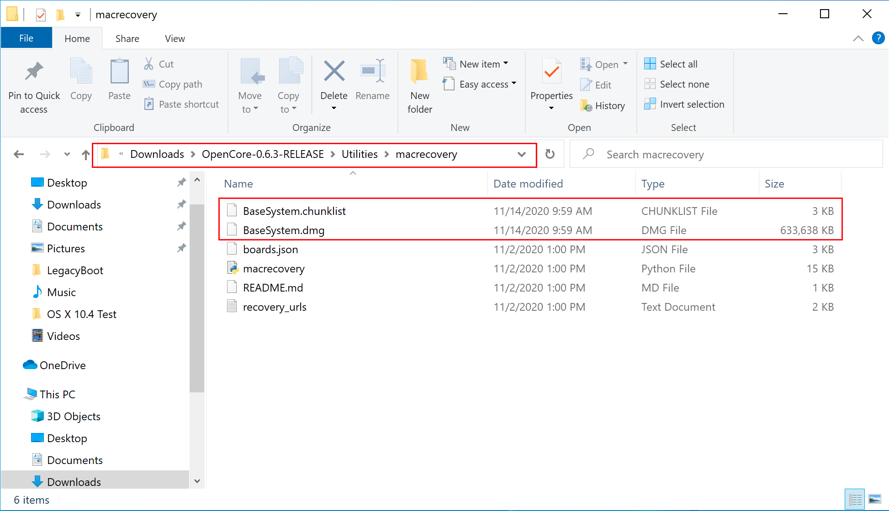
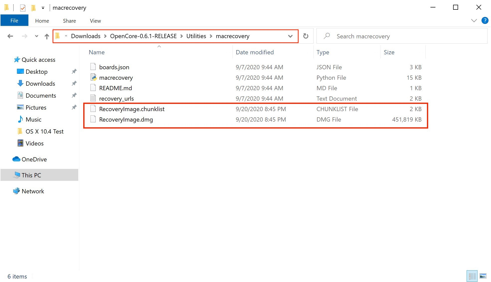

# Installing the driver from Windows

This assumes you don't want to create your own OpenCore EFI, however, if you do.. go to.. the OpenCore guide? Nothing here will be relevant bar post-installation.

To start you'll need the following:

* 4GB USB Stick

* [The 1401 Windows App](https://nullmothsystems.com/downloads)

## Downloading the 1401 Windows App

It's super duper easy. All you need to do, is click the good ol' 1401-Windows-x.xx.x.zip hyperlink, and unzip the folder to it's own. *Keep everything together*.

Now run <code>1401.exe</code>

| BaseSystem | RecoveryImage |
| :--- | :--- |
| |  |

## Booting The Thing

Here we'll be formatting our USB and adding macOS onto it, so buckle in, bud.

## Now with all this done, head to [actually installing it](installing.md) to.. well, *install it*.
