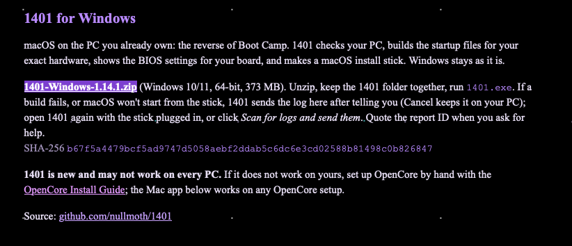
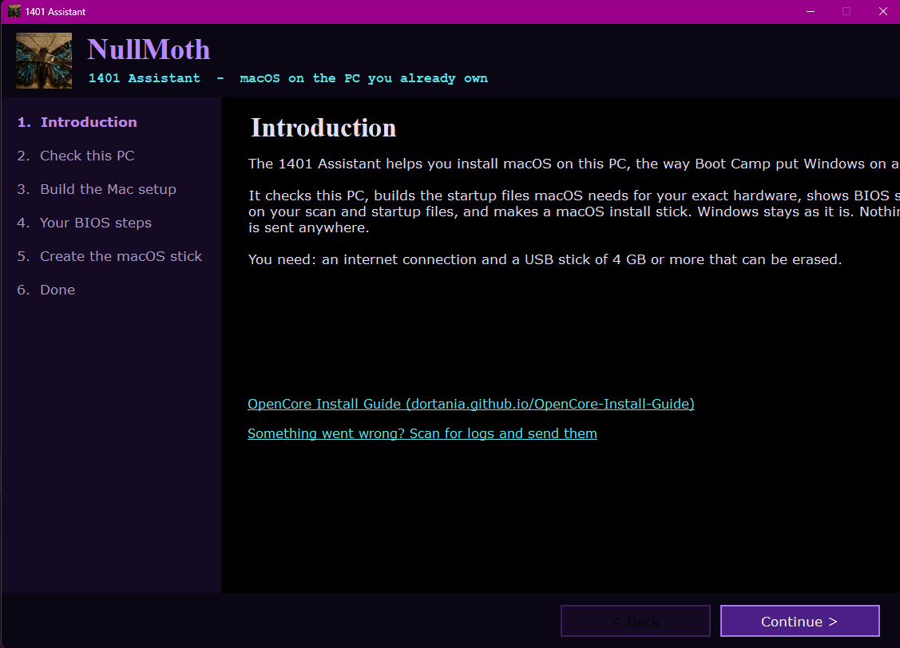
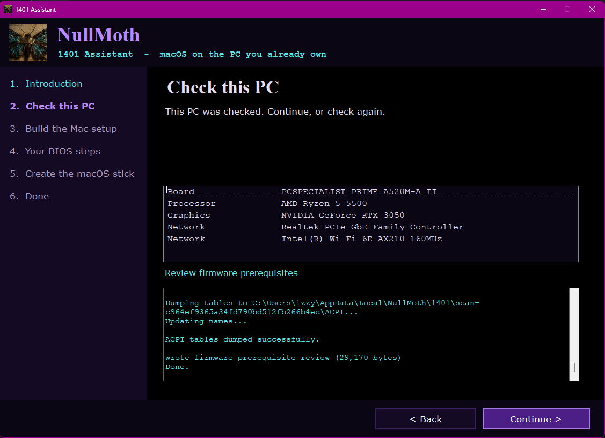
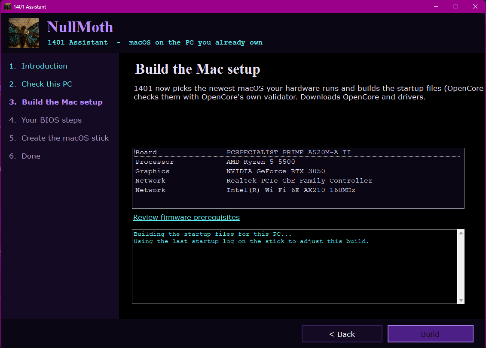
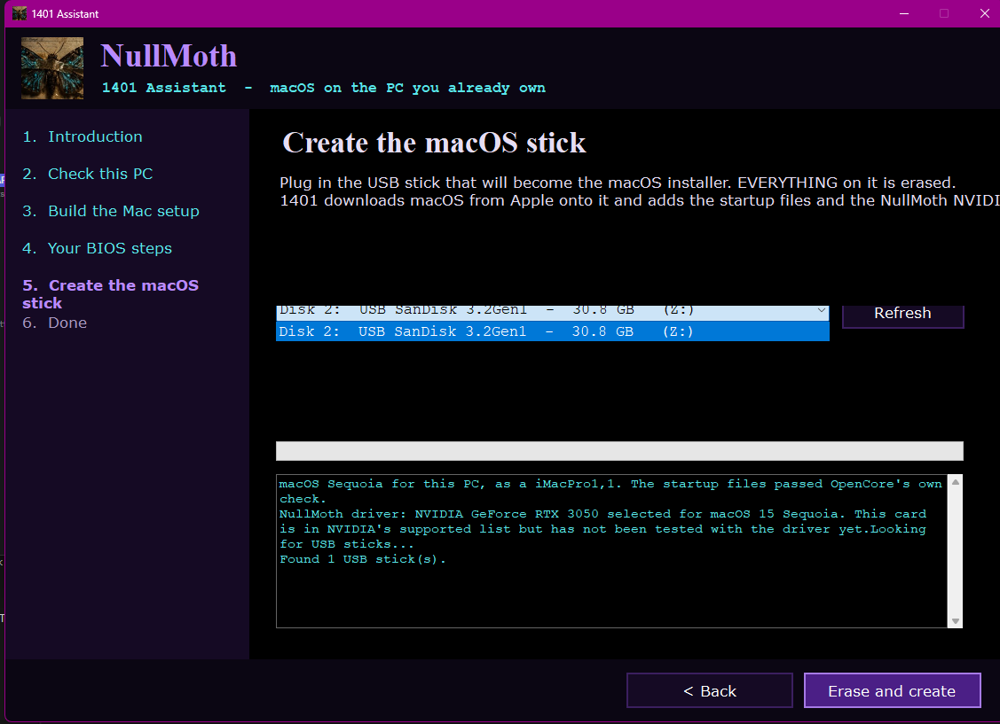

# Installing the driver from Windows

This assumes you don't want to create your own OpenCore EFI, however, if you do.. go to.. the OpenCore guide? Nothing here will be relevant bar post-installation.

To start you'll need the following:

* 4GB USB Stick

* [The 1401 Windows App](https://nullmothsystems.com/downloads)

## Downloading the 1401 Windows App

It's super duper easy. All you need to do, is click the good ol' 1401-Windows-x.xx.x.zip hyperlink, and unzip the folder to it's own. *Keep everything together*.

Now run <code>1401.exe</code>. You'll be greeted by the UI of the app itself.

It's relatively straight-forward. All you need to do from here is *RTFM*. Seriously, this guide is helpful, but the program tells you everything, including [problems with the app you might encounter, which you can read about and troubleshoot here.](../troubleshooting/1401.md)

Just click "Check this PC" and let it scan your hardware. Simples, right?

Once it actually finishes checking, you'll get a nice little report of your PC, which I'll use mine as an example. You can see it's an ASUS motherboar,d with a Ryzen CPU and a GeForce RTX 3050. *Take note of your wired/wireless NICs here.* Hopefully, yours is as simple as mine, as Realtek is supported with a kext, and so is Intel Wi-Fi.

From here, if everything looks good, click "Build". This will take a bit, so strap in and be patient.

| Check completed | Building the files.. |
| :--- | :--- |
| |  |

## BIOS steps

This is quite important to follow and read. This will tell you what BIOS settings you need to change. "But unidentified writer!" I hear you say, "I clicked past this page!" Well, fear not. As there are some BIOS options you should change, as described here:

::: details BIOS settings

Take note of these, and when you reboot in a bit, press the setup key for your PC (usually Del, F2, F10 or F1, you can find this with a quick Google search online searching the board)

| Setting | Option | Notes | 
| :--- | :--- | :--- | :--- | :--- |
| Secure Boot | Off | OpenCore is not signed, so it won't boot with it on. |
| CSM | Off | Issues can arise with CSM even just being on, even if you boot UEFI. Skip this if it doesn't exist. |
| Fast Boot | (Optionally) Off | Not needed, but can cause issues with USB detection in userspace, so.. maybe. |
| Above 4G Decoding | On  | Required by the NVIDIA driver, this maps memory above 4GB. This might be named differently for different BIOSes, but you should have this on already. |
| Re-size(able) BAR | On  | Required by the NVIDIA driver, apparently it stays on the startup text w/o this on. |
| XHCI/EHCI Hand-off | (Optionally) On  | Skip if you do not have this |
| IOMMU | (Optionally) Off  | You can keep this on, but if you have an AMD board and macOS is hanging, try turning this off. |
:::

Keep note of that, because now we're going to build our USB. On the next page, select the USB. Then click "Erase and create" (which, if it weren't obvious, this will erase your entire USB drive. Don't do it on a portable SSD with all your data on. **Check 100% to see that the device selected is the one you want to erase.**)

::: danger

Take note here - in the installer, unless your Wi-Fi card is natively supported,(fancy Broadcom users, cough cough), or you use Ethernet, you will *not* have an internet connection, and will be unable to install macOS from internet recovery. You can either use an Ethernet cable, granted your NIC was picked up, [Android tethering with HoRNDis](https://github.com/TomHeaven/HoRNDIS), or, if you have an Intel Wi-Fi card, hardcode your SSID/Password for the Wi-Fi you want in itlwm's <code>Info.plist</code>. You will be able to install Heliport in post-install to get your Intel Wi-Fi into a fancy GUI, but for setting the Wi-Fi values manually:

1. Open your USB from another machine, navigate to <code>EFI/OC/Kexts/itlwm.kext/Contents/Info.plist</code>.
2. Scroll down to WifiConfig, and under Wifi_1, enter your:
    * SSID (network name)
    * Password (self-explanitory)
It's in plain-text, mind.
:::

You can also just make a fully offline installer using [gibMacOS](https://github.com/corpnewt/gibMacOS) and [Unplugged](https://github.com/corpnewt/UnPlugged), but this will not be covered.

## Now with all this done, head to [actually installing it](installing.md) to.. well, *install it*.
